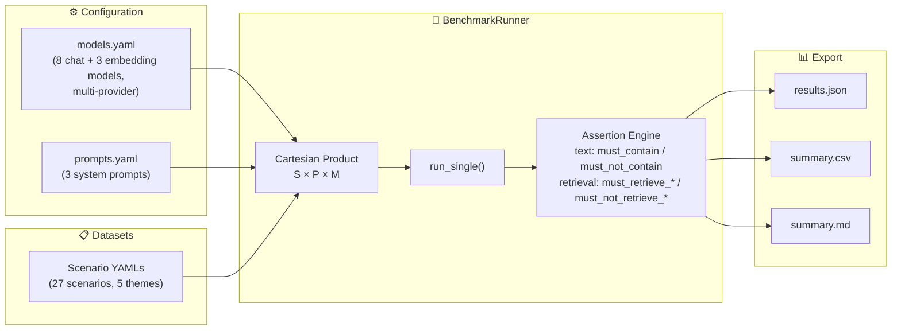
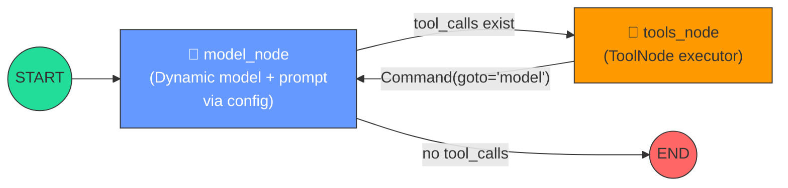
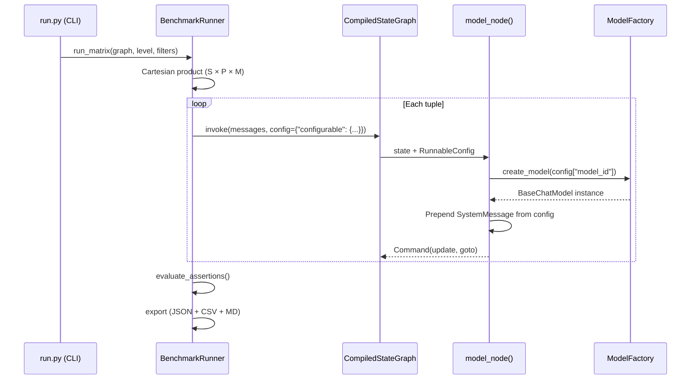

# 🧠 agent-memory-benchmark

**An experimental benchmark harness for evaluating memory architectures in LLM-based conversational agents.**

Measures how different persistence strategies affect logical consistency, belief revision, and information retention across multi-turn conversations — built with [LangGraph](https://langchain-ai.github.io/langgraph/), Pydantic v2, and a multi-provider model factory.

> **Theoretical basis.** The memory ladder evaluated by this harness (levels **L0–L4**, see
> [Agent Levels Roadmap](#agent-levels-roadmap)) was derived from the **CoALA** framework —
> *Cognitive Architectures for Language Agents*
> ([Sumers, Yao, Narasimhan & Griffiths, 2024](https://arxiv.org/abs/2309.02427), TMLR) — which
> factorizes a language agent into modular memory components (working, episodic, semantic and
> procedural memory), a structured action space and a decision-making loop. L0 and L1 correspond to
> the no-memory and working-memory rungs, L2 to episodic memory, and L3/L4 extend the taxonomy with
> reflection and an explicit belief state. Procedural memory (tools and prompts) is out of scope here.

[](https://www.python.org/downloads/)
[](LICENSE)
[](https://langchain-ai.github.io/langgraph/)
[](https://docs.pydantic.dev/latest/)

---

## Table of Contents

- [Research Context](#research-context)
- [Architecture](#architecture)
- [Benchmark Scenarios](#benchmark-scenarios)
- [Quickstart](#quickstart)
- [Usage](#usage)
- [Sample Results](#sample-results)
- [Agent Levels Roadmap](#agent-levels-roadmap)
- [Project Structure](#project-structure)
- [Research Log](#research-log)
- [Tech Stack](#tech-stack)
- [License](#license)

---

## Research Context

This project is the experimental component of an undergraduate thesis in Computer Science at **DCIC — Universidad Nacional del Sur** (Bahía Blanca, Argentina), supervised by **Dr. Alejandro J. García** and co-supervised by **Dr. Sebastián Gottifredi** at the **ICIC (CONICET-UNS)** Knowledge Representation & Reasoning (KRR) research group.

### Research Questions

| ID | Question |
|----|----------|
| **P1** | What is the minimal architecture needed to reliably manage contextual persistence across multiple sessions (*cross-thread*)? |
| **P2** | How does decoupling a reflection mechanism (*LLM-as-a-Judge*) affect handling of contradictory or extinct information (*A* vs. *¬A*)? |
| **P3** | What latency and token overhead does structured persistence introduce over a reactive (amnesic) baseline? |

The harness follows an **Evaluation-Driven Development (EDD)** methodology: benchmark scenarios with structured assertions are defined *before* building the agent architectures, ensuring that each design decision is empirically validated.

---

## Architecture

### Design Principle: Zero Hardcoding

Every benchmark execution is formalized as an **immutable tuple**:

$$\langle \text{Scenario},\, \text{System Prompt},\, \text{Model},\, \text{Persistence Level} \rangle$$

No graph or node has a model or prompt hardcoded at build time. All parameters are injected dynamically at runtime via LangGraph's `config["configurable"]` mechanism, enabling the runner to sweep the full **Cartesian product** (Scenarios × Prompts × Models) without any code changes.

### Harness Pipeline



### Agent Graph Topology (Level 0 — Reactive Baseline)



Routing is encapsulated **inside** each node via LangGraph `Command` objects — the modern post-0.2.x pattern — rather than external `add_conditional_edges()` declarations.

### Dynamic Injection Flow



### Cross-session retrieval semantics (L2)

`retrieve_node` calls `backend.retrieve(query, top_k, exclude_session_id=<current session id>)`
(`agents/level_2_episodic_rag/graph.py`), and the backend drops **only** `source="chat"` chunks whose
`session_id` is the current one (`agents/level_2_episodic_rag/backends/vector.py`). Two consequences
decide how every result must be read:

- L2 retrieves **chat turns from other sessions** plus **every** `source="document"` chunk. That is
  what makes cross-thread recall possible — and it is also why a superseded answer can come back as
  competing evidence against the document that supersedes it.
- A scenario that keeps `session_id` fixed for all turns retrieves **zero** chat episodes: it measures
  L1 (the checkpointer) plus write overhead, not the store. Only multi-session scenarios
  (`s1 → s2 → …`) exercise L2's retrieval.

| Run shape | Retrieved episodes | What the run actually measures |
|---|---|---|
| L0 | — | the model alone |
| L1 | — | intra-thread context (`MemorySaver`) |
| L2, single session | documents only (0 chat episodes) | L1 + append/embedding overhead |
| L2, multi-session | other sessions' chat + all documents | the episodic store and its slot competition |

### What L2 does not do

These are the properties the higher levels are meant to add; they are also the mechanism behind the
document-memory results in [`notes/`](notes/), so they are worth stating before any comparison:

- **No update or delete.** The store is append-only: a corrected or superseded fact becomes a second
  chunk, and both compete for the same `top_k` slots.
- **No preference signal.** One flat vector index over documents *and* chat, ranked by pure cosine
  similarity. `session_id`, `turn_number` and `source` are stored in the payload but never score, so
  recency and authority are invisible to retrieval.
- **No similarity floor.** `retrieve()` always returns `k` chunks, even on a chit-chat turn with no
  informational need (memory pollution).
- **No provenance in the prompt.** Since 2026-11-02 the injected memory block is **content only**: no
  `id`, `session`, `turn`, `source` or `score` header. Attribution lives in the telemetry
  (`retrieved_memories`), not in what the model sees.
- **No document priority.** A short chat echo whose text *is* the question plus the answer can outrank
  a long document chunk on the same topic, so a probe can be answered from the model's own previous
  answer instead of from the file.

---

## Benchmark Scenarios

**27 scenarios** across five themes. The tables below document the ones cited most often; the source
of truth is `datasets/conversations/` (`python run.py --list-scenarios`):

| Scenario | Category | Turns | Difficulty | Research Question | What It Tests |
|----------|----------|:-----:|:----------:|:-----------------:|---------------|
| `belief_revision_01` | Belief Revision | 5 | Basic | P2 | Agent updates beliefs when user contradicts a prior fact (*A → ¬A*) |
| `attrition_01` | Attrition | 8 | Moderate | P1 | Retention of early facts after 6 unrelated distractor turns |
| `needle_haystack_01` | Needle in Haystack | 5 | Moderate | P1 | Precise extraction of one detail from dense multi-entity context |
| `explicit_forget_01` | Selective Unlearning | 5 | Moderate | P2 | Formal retraction of a credential while preserving other facts |
| `temporal_multi_hop_01` | Multi-Hop Reasoning | 4 | Moderate | P1 | Compositional deduction over facts distributed across turns |
| `in_context_control_01` | Positive Control | 1 | Basic | P2 | Single-turn baseline — all premises in one prompt (upper bound) |

Each scenario is a YAML file with structured `assertions` per turn, enabling fully automated pass/fail evaluation without human judgment. Text assertions (`must_contain` / `must_not_contain`) grade the answer; retrieval assertions (`must_retrieve_chunk`, `must_not_retrieve_chunk`, `must_retrieve_source`, `must_not_retrieve_source`) grade what the retriever actually injected, so top-k dilution failures are causal rather than inferred.

### Document-memory scenarios (plan WS-D)

These scenarios ingest **documents** into memory instead of (or in addition
to) chat turns. See [`datasets/documents/README.md`](datasets/documents/README.md).

| Scenario | Category | Turns | What It Tests |
|----------|----------|:-----:|---------------|
| `document_needle_01` | Document Needle | 5 | A fact buried in a preloaded document must be recalled in a later session. The corpus (7 document chunks with the adjacent `ops_handbook.md`) now exceeds `top_k=5`, so the retriever must **select**; a precision turn checks the identifier never leaks unprompted |
| `document_addendum_revision_01` | Document Revision | 5 | A mid-conversation `system_event` supersedes a document section; every post-event probe pins the addendum chunk, and an addendum-only fact (the 2026-10-01 compliance window) is probed from a fresh session. Its cross-thread probe needs `top_k ≥ 3`: the addendum chunk ranks 3rd, behind the model's own previous answers |
| `document_dilution_01` | Document Dilution | 6 | Nine memos (eight audits + a scope note); three decoys share the probe phrase ("cold-storage medical biobank chamber") with a different serial. Probes cover the target, the near-miss disclaimer (Room 5's redundant loop), a second memo, refusal without over-disclosure, and a scope-note ticket (`FAC-2291`). Measured flat across `top_k` (9/9 at `k=1, 2, 5`) |
| `document_cross_thread_01` | Document Cross-Thread | 6 | Document facts retrieved from a new session whose chat history contains nothing, plus a precision turn (identifiers must not leak into an unrelated answer) |

### Scenario families

| Theme (`datasets/conversations/…`) | Scenarios | Focus |
|---|---:|---|
| `logical_consistency/` | 10 | belief revision, contradictions, modus tollens, document revision, explicit forget, entity binding, hallucination control |
| `retention_persistence/` | 8 | attrition, needle-in-haystack, document needle / dilution / cross-thread, top-k saturation |
| `compositional_reasoning/` | 5 | multi-hop and derived-fact probes, in-context controls |
| `robustness_security/` | 3 | adversarial forget, memory injection |
| `computational_cost/` | 1 | P3 overhead baseline |

---

## Quickstart

### Prerequisites

- Python 3.10+
- At least one LLM API key (Google AI Studio is free)
- **For L2 runs with local embeddings:** [Ollama](https://ollama.com) and
  `ollama pull qwen3-embedding:0.6b` — the embedding model used by every run documented in
  [`notes/`](notes/). Set `OLLAMA_BASE_URL` if it is not `http://localhost:11434`.

### Installation

```bash
git clone https://github.com/sgraziabile/agent-memory-benchmark.git
cd agent-memory-benchmark

# Create virtual environment
python -m venv .venv
.venv\Scripts\activate        # Windows
# source .venv/bin/activate   # macOS/Linux

# Install with dev dependencies
pip install -e ".[dev]"

# Configure environment
cp .env.example .env
# Edit .env and add your API key(s)
```

### Verify setup

```bash
pytest tests/ -v              # Run harness tests (no API keys needed)
python run.py --list-models   # List registered models
python run.py --list-scenarios
```

### Reproduce the documented runs

Every number quoted in [`notes/`](notes/) was produced with the configuration below. Quote it
alongside the results: several identity fields are **not** visible in `summary.md`.

```bash
python run.py --level 2 --scenario document_addendum_revision_01 \
    --model deepseek-v4-pro --prompt baseline_react \
    --backend vector --embedding-model qwen3-embedding-0.6b --top-k 5
```

| Identity field | Value in the documented runs | Exported in |
|---|---|---|
| `agent_level` | `level_2_episodic_rag` | `results.json`, `summary.csv` |
| `memory_backend` | `vector` | `results.json`, `summary.csv` |
| `embedding_model_id` | `qwen3-embedding-0.6b` (Ollama, 1024 dims) | `results.json`, `summary.csv` |
| `top_k` / `chunk_size` / `chunk_overlap` | `5` / `1200` / `200` | `results.json`, `summary.csv` |
| `corpus_chunks` | backend size at snapshot time (documents + chat episodes) | `results.json`, `summary.csv` |
| per-chunk provenance | `rank`, `score`, `source`, `char_count` | `results.json` → `turn_results[].retrieved_memories` |

> `summary.md` only carries scenario / model / prompt / level / turns / pass-rate / latency / tokens /
> errors. For `top_k`, the embedding model or the corpus size, read `summary.csv` (or `results.json`).

---

## Usage

### Run a single scenario

```bash
python run.py --model qwen3.6-27b --scenario belief_revision_01
```

### Run with a specific system prompt

```bash
python run.py --model qwen3.6-27b --scenario belief_revision_01 --prompt strict_epistemic
```

### Run all scenarios

```bash
python run.py --model qwen3.6-27b --scenario all
```

### Use an unregistered model (inline provider format)

```bash
python run.py --model nanogpt:z-ai/glm-5.3-flash --scenario attrition_01
python run.py --model nanogpt:moonshotai/kimi-k2.6 --scenario needle_haystack_01
```

### Add documents to memory (L2+)

Documents declared in a scenario YAML (`documents:` and `system_event`
`attachments:`) are chunked and appended to the episodic store with
`source="document"` — the chat model is never invoked, so ingestion costs
embedding tokens only. Sweep the retrieval/chunking axes from the CLI:

```bash
# Preload a document corpus and probe it (default top_k = 5)
python run.py --model qwen3.6-27b --scenario document_needle_01 --level 2

# Retrieval-cutoff sweep. Measured behaviour (notes/2026-11-03_l2_document_topk_ablation.md):
#   document_dilution_01          → flat: 9/9 at k = 1, 2 and 5
#   document_addendum_revision_01 → needs k >= 3: at k <= 2 its gold chunk falls outside the
#                                   window and the turn is answered from the model's own chat echo
python run.py --model qwen3.6-27b --scenario document_dilution_01 --level 2 --top-k 5
python run.py --model qwen3.6-27b --scenario document_addendum_revision_01 --level 2 --top-k 2

# Chunking ablation
python run.py --model qwen3.6-27b --scenario document_needle_01 --level 2 \
    --chunk-size 600 --chunk-overlap 100

# Control run: same conversation, empty corpus
python run.py --model qwen3.6-27b --scenario document_needle_01 --level 2 --no-documents
```

Ingestion volume/cost is reported separately from chat metrics:
`documents_ingested`, `ingested_chars`, `ingested_chunks`, `corpus_chunks`,
`ingestion_latency_ms` (see `results.json` / `summary.csv`), and snapshot
provenance lands in `outputs/runs/<ts>/memory/<run_id>/manifest.json`.

Repeat a corpus for free with the opt-in ingestion-embedding cache:

```bash
# Cold pass: ~110-160 s ingestion, 15,975 embedding tokens (8-doc D16 cell).
# Second identical run: same command, same 8/8, ingestion in ~10 ms, ~120 tokens
# (query embeddings only — queries are never cached).
python run.py --level 2 --model qwen3-8b --scenario document_corpus_size_008_01 \
    --chunk-size 600 --top-k 5 --embed-cache outputs/embed_cache
```

The cache stores chunk vectors keyed by `sha256(model, dims, text)` in
`outputs/embed_cache/<embedding-id>.sqlite` (git-ignored). `embedding_tokens`
then means tokens **actually sent**, and `embedding_cache_hits`/`_misses` travel
with the run (`results.json`, `summary.csv`,
`manifest.json` → `embedding.cache`) so a warm run is never mistaken for a faster
embedder. See `datasets/documents/README.md` § *Ingestion cost*.


### Available options

```
python run.py --help

  --model, -m       Model ID or provider:model_name  (default: qwen3.6-27b)
  --scenario, -s    Scenario ID or 'all'             (default: all)
  --prompt, -p      Prompt ID from prompts.yaml      (default: baseline_react)
  --level, -l       Level number(s), name, or 'all'   (default: 0; e.g. 1 or 0,1)
  --backend, -b     Memory backend for L2+ runs      (default: vector)
  --embedding-model Embedding model ID               (default: qwen3-embedding-8b)
  --top-k           Retrieval cut-off for L2+        (default: 5; 0 disables retrieval)
  --chunk-size      Max chars per chunk              (default: 1200)
  --chunk-overlap   Chars shared between chunks      (default: 200; must be < --chunk-size)
  --embed-batch-size Chunks per embedding request    (default: 8)
  --embed-cache DIR On-disk ingestion-embedding cache (default: off; ~0 s warm ingestion)
  --no-documents    Ignore documents/attachments (control runs)
  --verbose, -v     Enable debug logging
  --list-models     List registered models and exit
  --list-scenarios  List available scenarios and exit
  --list-prompts    List system prompts and exit
```

Results are exported automatically to `outputs/runs/<timestamp>/` in three formats: `results.json`, `summary.csv`, and `summary.md`.

---

## Sample Results

> **Historical sample.** The table below is from the first L0 sweep (`gemini-3.5-flash-lite`, before
> the scenario-hardening pass) and is kept as an illustration of the amnesic baseline — not as the
> current state of the benchmark. For L2 results see [`notes/`](notes/).

### Level 0 Baseline — `gemini-3.5-flash-lite` × `baseline_react`

These results demonstrate the **amnesic baseline** (no checkpointer, no memory, no persistence):

| Scenario | Pass Rate | Avg Latency | Total Tokens | Outcome |
|----------|:---------:|:-----------:|:------------:|---------|
| `in_context_control_01` | **100.0%** | 1,709 ms | 192 | ✅ Upper bound — all context in single turn |
| `attrition_01` | **66.7%** | 1,844 ms | 1,477 | ⚠️ Partial recall — early facts partially retained |
| `temporal_multi_hop_01` | **50.0%** | 1,867 ms | 513 | ⚠️ Cannot compose facts across turns |
| `explicit_forget_01` | **40.0%** | 1,875 ms | 758 | ⚠️ Amnesia trivially passes forget, but fails recall |
| `belief_revision_01` | **28.6%** | 10,929 ms | 715 | ❌ Fails to update beliefs across turns |
| `needle_haystack_01` | **0.0%** | 2,504 ms | 937 | ❌ Fails dense multi-entity retrieval |

> **Key insight:** The positive control (`in_context_control_01`) achieves 100% as expected — the model *can* process contradictions when all premises are in a single prompt. Failures in multi-turn scenarios confirm that the degradation is a **persistence problem**, not a reasoning problem. This validates the thesis hypothesis and motivates Level 1+ architectures.

> **Measurement validity:** Model instances are cached per configuration (`lru_cache` in `core/model_factory.py`), so after the first invocation per `(model_id, temperature, config)` tuple, each measured turn reflects model inference and graph orchestration only — not YAML re-reads or provider client construction. Additionally, errored turns (e.g., API outages) are flagged and excluded from pass-rate, latency, and token metrics, so infrastructure failures never contaminate benchmark numbers.

---

## Agent Levels Roadmap

The harness evaluates agents across an **ablation ladder** of increasing persistence, derived from the
memory taxonomy of [CoALA](https://arxiv.org/abs/2309.02427) (Sumers et al., 2024):

| Level | Name | Persistence | Status |
|:-----:|------|-------------|:------:|
| **L0** | Reactive (Amnesic) | None — stateless baseline | ✅ Implemented |
| **L1** | Working Memory | `MemorySaver` checkpointer — within-thread persistence | ✅ Implemented |
| **L2** | Episodic Naive RAG | Cross-thread accumulative (*append-only*) store — `vector` backend implemented, `markdown`/BM25 deferred | ✅ Implemented ([Plan](TODOs/phase-2-l2-plan.md)) |
| **L3** | Reflective Memory | L2 + active CRUD mutation & LLM-as-a-Judge conflict resolution | 🔲 Planned |
| **L4** | Structured Belief State | L3 + explicit belief graph with revision operators | 🔲 Planned |

Each level shares the same runner, scenarios, and assertion engine — only the agent graph changes. The `BaseBenchmarkAgent` abstract interface enforces this contract.

---

## Project Structure

```
agent-memory-benchmark/
├── agents/
│   ├── base.py                          # Abstract BaseBenchmarkAgent interface
│   ├── level_0_reactive/
│   │   └── graph.py                     # L0 stateless graph (Command routing)
│   ├── level_1_working_memory/
│   │   └── graph.py                     # L1 intra-thread graph (MemorySaver)
│   └── level_2_episodic_rag/
│       ├── graph.py                     # L2 retrieve → model → append (Naive RAG)
│       └── backends/                    # EpisodeRecord contract + vector backend
├── configs/
│   ├── models.yaml                      # Chat + embedding model registry
│   └── prompts.yaml                     # 3 system prompts (baseline, epistemic, minimal)
├── core/
│   ├── documents.py                     # WS-D: document resolution, loading, records
│   ├── model_factory.py                 # Dynamic multi-provider LLM instantiator
│   ├── runner.py                        # Cartesian product orchestrator + export
│   └── schemas.py                       # Pydantic v2 contracts + LangGraph state
├── datasets/
│   ├── documents/                       # WS-D document corpus + generator docs
│   └── conversations/                   # Scenario YAMLs, organized by research theme
│       ├── logical_consistency/         # belief_revision, document_revision, explicit_forget, ...
│       ├── retention_persistence/       # attrition, needle_haystack, document_needle, document_dilution, ...
│       ├── compositional_reasoning/     # in_context_multihop, temporal_multi_hop
│       ├── robustness_security/         # adversarial_forget, memory_injection
│       └── computational_cost/          # overhead_baseline (P3)
├── outputs/
│   ├── runs/                            # Timestamped results (JSON + CSV + Markdown + memory/)
│   └── by_theme/                        # Runs reorganized by theme/category (generated)
├── archive/                             # Deprecated runs kept for provenance
├── notes/                               # Experiment write-ups (results, caveats, next steps)
├── TODOs/                               # Phase plans, stress-test designs, open decisions
├── scripts/
│   ├── add_scenario.py                  # Materialize YAML blocks from a stage spec
│   ├── generate_corpus.py               # Deterministic synthetic document corpus
│   ├── organize_datasets.py             # Reorganize scenario YAMLs by theme
│   ├── reorganize_outputs.py            # Group runs by theme under outputs/by_theme/
│   └── token_report.py                  # Token/latency breakdown per run
├── tests/                               # Harness, L2 and scenario-shape tests (no API keys)
│   ├── test_document_ingestion.py       # Document scenarios + ingestion
│   ├── test_harness_m3.py               # Telemetry capture
│   ├── test_harness_m5.py               # Backend injection and CLI flags
│   ├── test_l2_contracts.py             # EpisodeRecord + backend protocol
│   ├── test_l2_graph.py                 # L2 graph behaviour
│   ├── test_l2_vector_backend.py        # Chunking, ranking, telemetry
│   ├── test_scaffolding.py              # Base agent/harness contracts
│   ├── test_stage4_scenarios.py         # Stage 4 scenario-shape guards
│   └── test_stage5_scenarios.py         # Stage 5 scenario-shape guards
├── .env.example                         # Environment variable template
├── pyproject.toml                       # Dependencies and build config
├── SPEC.md                              # Technical specification (Spanish)
└── README.md                            # This file
```

---

## Research Log

The README documents the harness; the **results, caveats and next steps** live in [`notes/`](notes/).

| Note | What it covers |
|---|---|
| [`2026-10-30_l2_episodic_rag_summary.md`](notes/2026-10-30_l2_episodic_rag_summary.md) | First L2 sweep (14 valid runs): cross-thread recall closes P1, non-monotonic reasoning is the ceiling, P3 cost quantified, and the runs that never exercise the store |
| [`2026-11-03_l2_document_topk_ablation.md`](notes/2026-11-03_l2_document_topk_ablation.md) | `top_k ∈ {1, 2, 5}` on both document scenarios: dilution is flat (9/9 at every `k`), addendum is cutoff-coupled — its gold chunk ranks 3rd, behind the model's own chat echo |
| [`2026-10-14_l1_three_model_comparison.md`](notes/2026-10-14_l1_three_model_comparison.md) | L1 across three models |
| [`2026-10-09_adversarial_forget_summary.md`](notes/2026-10-09_adversarial_forget_summary.md) | Adversarial forget (P2) |

Design documents — open decisions, defect logs (X1–X10), rules R1–R10 and the staged experiment
matrix — are in [`TODOs/`](TODOs/); the document-memory stress plan is
[`TODOs/phase-2-l2-document-stress-plan.md`](TODOs/phase-2-l2-document-stress-plan.md).

---

## Tech Stack

| Component | Technology |
|-----------|-----------|
| Agent Framework | [LangGraph](https://langchain-ai.github.io/langgraph/) ≥ 0.2.0 |
| Data Contracts | [Pydantic](https://docs.pydantic.dev/latest/) v2 |
| LLM Providers | Google GenAI, OpenAI, Anthropic, NanoGPT, Ollama |
| Scenario Format | YAML with structured assertion rules |
| Testing | pytest ≥ 8.0, pytest-asyncio |
| Packaging | Hatchling (`pyproject.toml`) |
| Tracing | LangSmith (optional) |

---

## License

[MIT](LICENSE) — Stefano Grazia
