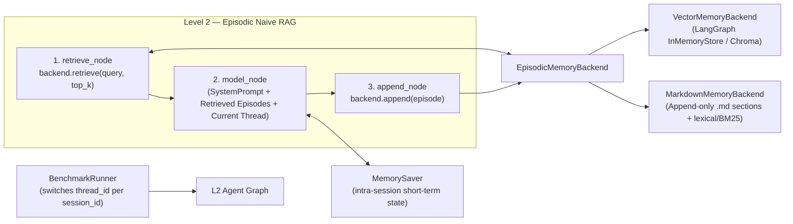

# 🗺️ TODO: Phase 2 — Level 2 Accumulative Episodic Memory (Naive RAG)

> **Status:** PLANNED (recorded 2026-10-19) — 2-week implementation & foundation window.
> **Scope:** Implement **Level 2 (L2)** as an **accumulative (*append-only*) episodic memory** using **Naive RAG** across two swappable storage backends (**VectorDB** and **Markdown `.md` files**). Active state mutation, conflict pruning, and selective deletion (`UPDATE` / `DELETE`) are intentionally excluded from L2 and reserved for **Level 3 (Reflective / CRUD Memory)** and **Level 4 (Structured Belief State)**.
> **Coding Agent Instructions:** Wait for explicit user instructions before implementing individual milestones.

---

## 1. Architectural Role of Level 2 in the Ablation Ladder

| Level | Name | Persistence Policy | Target Capability | Expected Structural Failure Mode |
|:---:|---|---|---|---|
| **L0** | Reactive (Amnesic) | Stateless (none) | Single-turn in-context controls | All multi-turn recall & revision |
| **L1** | Working Memory | `MemorySaver` (intra-thread) | Multi-turn recall within one `thread_id` (saturated at 100% on 7/7 recall tests) | **Cross-thread amnesia** (0% when `thread_id` changes) & context-window overflow |
| **L2** | **Episodic Naive RAG** | **Cross-thread, append-only** (`VectorDB` or `.md`) | **Cross-session retention** & large-document retrieval | **Stale/contradictory chunk collision** on belief revision & **re-exposure of revoked secrets** on explicit forget (no deletion mechanism) |
| **L3** | Reflective / CRUD Memory | L2 + active state mutation (`ADD` / `UPDATE` / `DELETE`) + LLM-as-a-Judge reflection | Atomic belief revision & mechanism-backed selective forgetting | Multi-hop derived-belief invalidation & defeasible exceptions |
| **L4** | Structured Belief State | L3 + explicit belief graph & revision operators | Derived-belief retraction (facts + rules) & non-monotonic specificity | Computational & token overhead (P3) |

### Why L2 Must Be Strictly Append-Only (Naive RAG)
1. **Preserves SPEC §2 Rule 3 ("Persistence Isolation — frozen tool bindings"):** By modeling L2 as a deterministic Naive RAG pipeline (`START → retrieve_node → model_node → append_node → END`), the LLM requires **zero new tool bindings**, keeping the control surface identical to L0 and L1.
2. **Establishes the Empirical Baseline for L3:** When a user updates a fact ($A \to \neg A$), uploads an addendum to a large document, or revokes a secret (`9173`) in Session 2, L2 simply **appends** the new episode without erasing Session 1. In Session 3, top-$k$ retrieval surfaces either the stale episode or both conflicting episodes simultaneously, empirically measuring the failure rate of accumulative RAG before L3 introduces state mutation.

---

## 2. Graph Topology & Execution Flow

1. **`retrieve_node`:** Queries the configured `EpisodicMemoryBackend` using the current user turn's text and retrieves up to `top_k` episodes/chunks from prior sessions (or ingested documents). Formats each retrieved item with explicit provenance headers (e.g., `[Memory | session=S1, turn=2, source=chat]: ...`).
2. **`model_node`:** Prepends an ephemeral `SystemMessage` combining `system_prompt` and the formatted retrieved context, followed by `state["messages"]` (the current session's in-thread history from `MemorySaver`).
3. **`append_node`:** Appends the completed turn `(user_input, ai_response, session_id, turn_number, timestamp)` to the persistent backend.

---

## 3. Storage Backends (Maximum Two Techniques)

Both backends implement a single abstract protocol (`EpisodicMemoryBackend`) with four methods:
- `append(record: EpisodeRecord) -> None`
- `retrieve(query: str, top_k: int) -> list[RetrievedEpisode]`
- `reset() -> None` (called between benchmark tuples for run isolation)
- `export_snapshot(dest_dir: Path) -> None` (persists final memory state alongside `results.json`)

### 3.1 Backend A: `VectorMemoryBackend` (Sub-symbolic / Dense Semantic Retrieval)
- **Storage engine:** LangGraph's native `InMemoryStore(index={"embed": ..., "dims": 1024})` (or local persistent `Chroma` if on-disk inspection is required).
- **Embedding model (held constant across all sweeps):** API-based `BAAI/bge-m3` (`1024` dims, `8192` max tokens, \$0.01/1M tokens) or `Qwen/Qwen3-Embedding-0.6B` via NanoGPT's OpenAI-compatible `/api/v1/embeddings` endpoint (`langchain-openai` `OpenAIEmbeddings`), registered under a top-level `embeddings:` key in `configs/models.yaml` and cached via `@lru_cache` in `core/model_factory.py`.
  - *Rationale for API over local execution:* The development machine runs an Intel Core i5-1334U with integrated Intel UHD Graphics (no CUDA GPU); local inference on 600M+ parameter models during large-file chunk ingestion would bottleneck on CPU and distort P3 latency metrics.
  - *Unit-test stub:* Use `DeterministicFakeEmbedding(size=1024)` from `langchain_core.embeddings` in `tests/` so `pytest` stays 100% offline and API-key-free.
- **Chunking:** `RecursiveCharacterTextSplitter` (configurable `chunk_size`, default ~500 tokens, `chunk_overlap` ~50 tokens) for large documents and long turns.

### 3.2 Backend B: `MarkdownMemoryBackend` (Structured Text / Lexical Section Retrieval)
- **Storage layout:** Append-only Markdown files written inside a run-scoped directory (`outputs/runs/<ts>/memory/<run_id>/`):
  - `episodes.md`: chronological log where each turn is appended as a level-2 Markdown section (`## [session=S1 | turn=2 | source=chat]`).
  - `documents/<doc_id>.md`: ingested large documents split into Markdown sections.
  - `index.md`: automatically updated manifest of stored sessions and document sections.
- **Retrieval (`retrieve`):** Splits stored `.md` files by section headers and ranks top-$k$ sections via **lexical matching / BM25 token overlap** (zero embeddings).
- **Testable comparative hypothesis (VectorDB vs. `.md`):**
  - `VectorMemoryBackend` should outperform on **paraphrased semantic queries** where query and stored episode share no lexical stems.
  - `MarkdownMemoryBackend` should outperform on **exact alphanumeric identifiers, credentials, and server codes** (`EMP-8042`, `AK-9988-X`, `9173`, `srv-alpha`), where dense embeddings dilute token-exact signals, while providing human-readable audit trails.

---

## 4. Required Harness & Schema Extensions

1. **Multi-Session (`thread_id`) Support (`core/schemas.py` & `core/runner.py`):**
   - Add `session_id: str = "default"` and optional `attachments: list[str] = Field(default_factory=list)` to `ConversationTurn`.
   - In `BenchmarkRunner.run_single()`, compute the per-turn LangGraph `thread_id` as `f"{run_id}_{scenario.id}_{turn.session_id}"`. Existing single-session YAMLs omit `session_id` and default to `"default"`, preserving 100% backward compatibility.
2. **Retrieval & Embedding Observability (`core/schemas.py`):**
   - Add `retrieved_memories: list[dict[str, Any]] = Field(default_factory=list)` and `embedding_latency_ms: float = 0.0` to `TurnResult`.
   - Recording `retrieved_memories` in `results.json` separates **retrieval failures** (the right chunk was not in top-$k$) from **reader/attention failures** (the chunk was retrieved, but the LLM ignored it or picked the outdated chunk).
3. **Deterministic Large-File Ingestion (`system_event`):**
   - Implement `role: "system_event"` in `BenchmarkRunner.run_single()` (closing Audit §3.8): when a `system_event` turn carries an attachment path or document payload, the runner chunks and appends it directly into the active `EpisodicMemoryBackend` without invoking the chat model.
4. **Multi-Message Token Accounting Guard (`core/runner.py`):**
   - Sum `usage_metadata` across all newly added `AIMessage` instances in a turn (rather than inspecting only the last `AIMessage`) so future tool-enabled levels (L3+) never undercount intermediate LLM calls.

---

## 5. Target Evaluation Scenarios for Phase 2

1. **`test_cross_thread_01.yaml` (Stage 3.1):** Facts seeded in `session_id: "s1"`, probed in `session_id: "s2"`. Validates that L0 and L1 score 0% (amnesia) while L2 scores 100%.
2. **`test_doc_needle_01.yaml` (Large File Retrieval):** A multi-section synthetic specification ingested via `system_event` in `s1`; needle and multi-chunk queries probed in `s2` (comparing semantic paraphrase queries vs. exact ID queries across VectorDB and `.md`).
3. **Cross-Thread `belief_revision` & `explicit_forget`:** Existing scenarios split across sessions (`s1`: initial fact/PIN $\to$ `s2`: correction/retraction $\to$ `s3`: probe) to empirically measure how L2's append-only store surfaces stale facts alongside corrections and re-injects revoked secrets into `retrieved_memories`.
4. **`test_document_addendum_revision_01.yaml` (Stage 5.3):** Large document in `s1` + compact addendum in `s2` + compositional probe in `s3`, measuring top-$k$ competition between original chunks and addendum chunks.

---

## 6. Two-Week Implementation Schedule

### Week 1: Reading, Multi-Session Harness & Vector Backend
- **Day 1:** Literature review — Gao et al. 2023 ([arXiv:2312.10997](https://arxiv.org/abs/2312.10997), Naive RAG taxonomy), Sumers et al. 2023 ([arXiv:2309.02427](https://arxiv.org/abs/2309.02427), CoALA), and LangGraph `BaseStore` documentation. Finalize `EpisodicMemoryBackend` protocol.
- **Day 2:** Extend `ConversationTurn` (`session_id`, `attachments`) and `TurnResult` (`retrieved_memories`, `embedding_latency_ms`). Update `BenchmarkRunner` for per-session `thread_id` switching, `system_event` document ingestion, and per-run memory reset/snapshot. Add unit tests in `tests/`.
- **Day 3:** Add `create_embeddings()` to `core/model_factory.py` + `embeddings:` entry in `configs/models.yaml`. Implement `VectorMemoryBackend` (chunking + `InMemoryStore` vector index).
- **Day 4:** Implement `agents/level_2_episodic_rag/graph.py` (`retrieve_node → model_node → append_node`) with dynamic `top_k` and backend selection via `config["configurable"]`.
- **Day 5:** Author `test_cross_thread_01.yaml` and run verification sweep across L0, L1, and L2-Vector. **Week 1 Milestone:** L0/L1 fail cross-thread recall (0%); L2-Vector passes (100%) with full `retrieved_memories` telemetry.

### Week 2: Markdown Backend, Large Documents & Append-Only Collision Analysis
- **Days 1–2:** Implement `MarkdownMemoryBackend` (append-only `.md` section writer, `index.md` generator, and lexical/BM25 section retriever) behind the same `EpisodicMemoryBackend` interface.
- **Day 3:** Generate synthetic large multi-section document + addendum fixtures. Implement `test_doc_needle_01.yaml` and `test_document_addendum_revision_01.yaml`.
- **Day 4:** Adapt `belief_revision` and `explicit_forget` to multi-session format (`s1`/`s2`/`s3`) to stress-test append-only collision and zombie-memory retrieval.
- **Day 5:** Execute comparative sweep (`L2-Vector` vs. `L2-Markdown`) across 2–3 models, export snapshots and P3 latency/token breakdowns, and write an experiment note in `notes/` for thesis supervision review.

---

## 7. Core Reading List (Verified References)

- **Naive RAG & Retrieval Foundations:**
  - Gao et al. (2023) — *Retrieval-Augmented Generation for Large Language Models: A Survey* ([arXiv:2312.10997](https://arxiv.org/abs/2312.10997))
  - Lewis et al. (2020) — *Retrieval-Augmented Generation for Knowledge-Intensive NLP Tasks* ([arXiv:2005.11401](https://arxiv.org/abs/2005.11401))
  - Liu et al. (2023) — *Lost in the Middle: How Language Models Use Long Contexts* ([arXiv:2307.03172](https://arxiv.org/abs/2307.03172))
  - Anthropic (2024) — *Introducing Contextual Retrieval* (chunk boundary context + lexical/BM25 hybrid retrieval)
- **Embeddings:**
  - Reimers & Gurevych (2019) — *Sentence-BERT: Sentence Embeddings using Siamese BERT-Networks* ([arXiv:1908.10084](https://arxiv.org/abs/1908.10084))
  - Muennighoff et al. (2022) — *MTEB: Massive Text Embedding Benchmark* ([arXiv:2210.07316](https://arxiv.org/abs/2210.07316))
- **Agent Memory Taxonomies & Benchmarks:**
  - Sumers et al. (2023) — *Cognitive Architectures for Language Agents (CoALA)* ([arXiv:2309.02427](https://arxiv.org/abs/2309.02427))
  - Park et al. (2023) — *Generative Agents: Interactive Simulacra of Human Behavior* ([arXiv:2304.03442](https://arxiv.org/abs/2304.03442))
  - Wu et al. (2024) — *LongMemEval: Benchmarking Chat Assistants on Long-Term Interactive Memory* ([arXiv:2410.10813](https://arxiv.org/abs/2410.10813))
  - Hu et al. (2025) — *Evaluating Memory in LLM Agents via Incremental Multi-Turn Interactions (MemoryAgentBench)* ([arXiv:2507.05257](https://arxiv.org/abs/2507.05257))
  - Packer et al. (2023) — *MemGPT: Towards LLMs as Operating Systems* ([arXiv:2310.08560](https://arxiv.org/abs/2310.08560)) & Chhikara et al. (2025) — *Mem0* ([arXiv:2504.19413](https://arxiv.org/abs/2504.19413)) *(contrast baselines for L3)*
