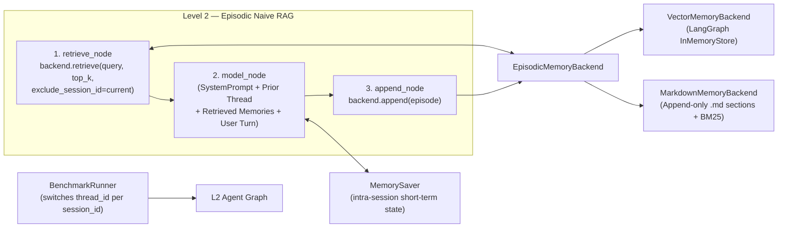

# 🗺️ TODO: Phase 2 — Level 2 Accumulative Episodic Memory (Naive RAG)

> **Status:** PLANNED (recorded 2026-10-19; refined 2026-10-21) — 2-week implementation & foundation window.
> **Scope:** Implement **Level 2 (L2)** as an **accumulative (*append-only*) episodic memory** using **Naive RAG** across two swappable storage backends (**VectorDB** and **Markdown `.md` files**). Active state mutation, conflict pruning, and selective deletion (`UPDATE` / `DELETE`) are intentionally excluded from L2 and reserved for **Level 3 (Reflective / CRUD Memory)** and **Level 4 (Structured Belief State)**.
> **Coding Agent Instructions:** Wait for explicit user instructions before implementing individual milestones.

---

## 1. Architectural Role of Level 2 in the Ablation Ladder

| Level | Name | Persistence Policy | Target Capability | Expected Structural Failure Mode |
|:---:|---|---|---|---|
| **L0** | Reactive (Amnesic) | Stateless (`none`) | Single-turn in-context controls | All multi-turn recall & revision |
| **L1** | Working Memory | `MemorySaver` (intra-thread) | Multi-turn recall within one `thread_id` (saturated at 100% on 7/7 recall tests) | **Cross-thread amnesia** (0% when `thread_id` changes) & context-window overflow |
| **L2** | **Episodic Naive RAG** | **Cross-thread, append-only** (`VectorDB` or `.md`) | **Cross-session retention** & large-document retrieval | **Stale/contradictory chunk collision** on belief revision & **re-exposure of revoked secrets** on explicit forget (no deletion mechanism) |
| **L3** | Reflective / CRUD Memory | L2 + active state mutation (`ADD` / `UPDATE` / `DELETE`) + LLM-as-a-Judge reflection | Atomic belief revision & mechanism-backed selective forgetting | Multi-hop derived-belief invalidation & defeasible exceptions |
| **L4** | Structured Belief State | L3 + explicit belief graph & revision operators | Derived-belief retraction (facts + rules) & non-monotonic specificity | Computational & token overhead (P3) |

### Why L2 Must Be Strictly Append-Only (Naive RAG)
1. **Preserves SPEC §2 Rule 3 ("Persistence Isolation — frozen tool bindings"):** By modeling L2 as a deterministic Naive RAG pipeline (`START → retrieve_node → model_node → append_node → END`), the LLM requires **zero new tool bindings**, keeping the control surface identical to L0 and L1.
2. **Establishes the Empirical Baseline for L3:** When a user updates a fact ($A \to \neg A$), uploads an addendum to a large document, or revokes a secret (`9173`) in Session 2, L2 simply **appends** the new episode without erasing Session 1. In Session 3, top-$k$ retrieval surfaces either the stale episode or both conflicting episodes simultaneously, empirically measuring the failure rate of accumulative RAG before L3 introduces state mutation.

---

## 2. Graph Topology, Prompt Layout & Execution Flow



### Node Execution Semantics

1. **`retrieve_node` (Self-Retrieval Filtered):**
   - Queries the configured `EpisodicMemoryBackend` using the current user turn's text and retrieves up to `top_k` episodes/chunks.
   - **Intra-session deduplication guard:** Because `MemorySaver` already retains all prior turns of the **current** `session_id` in `state["messages"]`, `retrieve_node` passes `exclude_session_id=current_session_id` for conversational episodes (`source == "chat"`), while **always allowing** `source == "document"` chunks regardless of `session_id`. This prevents current-session chat turns from duplicating `MemorySaver` history in the prompt or crowding out prior-session episodes and document chunks in top-$k$.
   - Formats each retrieved item with explicit provenance headers:
     ```text
     [Memory #1 | id=ep_s1_t2_0 | session=s1 | turn=2 | source=chat | score=0.842]
     User: ...
     Assistant: ...
     ```

2. **`model_node` (Prefix-Cache-Preserving Context Injection):**
   - Constructs the ephemeral message list sent to `model.invoke()` in the following exact order:
     $$[\,\text{SystemMessage}(\texttt{system\_prompt}),\; *\texttt{prior\_thread\_messages},\; \text{SystemMessage}(\texttt{retrieved\_memories\_block}),\; \texttt{latest\_human\_message}\,]$$
   - **Why retrieved context is injected right before `latest_human_message` (not at index 0):** Retrieved chunks change on every turn. Keeping `SystemMessage(system_prompt)` and `*prior_thread_messages` static at the prefix preserves provider prompt caching (`input_token_details.cache_read` on DeepSeek/OpenAI) across turns within a session and keeps retrieved evidence adjacent to the active query.
   - Neither `SystemMessage` is persisted into `MemorySaver` state, preventing system/RAG prompt accumulation across turns.

3. **`append_node` (Turn Persistence):**
   - Formats the completed turn as `User: {user_input}\nAssistant: {ai_response}` so both user-stated facts and assistant-articulated derived conclusions (required by Stage 5.1 `test_derived_belief_revision_01`) are persisted.
   - Splits the formatted episode via `RecursiveCharacterTextSplitter` if it exceeds `chunk_size`, and appends the resulting `EpisodeRecord`(s) (`session_id`, `turn_number`, `source="chat"`, `timestamp`) to the backend.

4. **`AgentState` Telemetry Channels (`core/schemas.py`):**
   - Extend `AgentState` (or define `L2AgentState(AgentState)`) with per-turn overwrite fields (no `add_messages` reducer) so `BenchmarkRunner` can read node telemetry directly from `agent_graph.invoke()` output:
     - `retrieved_memories: list[dict[str, Any]]`
     - `retrieved_context_chars: int`
     - `retrieved_context_tokens: int`
     - `retrieval_latency_ms: float`
     - `append_latency_ms: float`
     - `embedding_latency_ms: float`
     - `embedding_tokens: int`
     - `appended_chunk_ids: list[str]`

---

## 3. Storage Backends & Memory Snapshot Specification

### 3.1 `EpisodicMemoryBackend` Protocol & Data Contracts

Both backends implement a unified abstract interface (`agents/level_2_episodic_rag/backends/base.py`):

```python
class EpisodeRecord(BaseModel):
    chunk_id: str                  # e.g. "ep_s1_t2_0" or "doc_spec01_c03"
    session_id: str                # e.g. "s1"
    turn_number: int               # 1-based turn index
    source: Literal["chat", "document"]
    content: str                   # chunk or section text
    char_count: int
    estimated_tokens: int          # len(content) // 4 or tiktoken cl100k_base count
    timestamp: str                 # UTC ISO-8601
    metadata: dict[str, Any] = Field(default_factory=dict)  # doc_id, section_title, etc.

class RetrievedEpisode(BaseModel):
    chunk_id: str
    session_id: str
    turn_number: int
    source: Literal["chat", "document"]
    content: str
    score: float                   # cosine similarity (vector) or BM25 score (markdown)
    rank: int                      # 1-based rank in top_k
    char_count: int
    estimated_tokens: int
    metadata: dict[str, Any] = Field(default_factory=dict)
```

Protocol methods:
- `append(records: list[EpisodeRecord]) -> AppendTelemetry` (returns `append_latency_ms`, `embedding_latency_ms`, `embedding_tokens`, `chunk_ids`)
- `retrieve(query: str, top_k: int, *, exclude_session_id: str | None = None) -> RetrievalTelemetry` (returns `episodes: list[RetrievedEpisode]`, `retrieval_latency_ms`, `embedding_latency_ms`, `embedding_tokens`)
- `reset() -> None` (clears all stored state between benchmark tuples for strict run isolation)
- `export_snapshot(dest_dir: Path, run_metadata: dict[str, Any]) -> Path` (writes the human-auditable memory artifacts for the run)

### 3.2 Backend A: `VectorMemoryBackend` (Sub-symbolic / Dense Semantic Retrieval)
- **Storage engine:** LangGraph's native `InMemoryStore(index={"embed": embeddings, "dims": dims})`.
- **Embedding model (held constant across sweeps):**
  - Primary: API-based `Qwen/Qwen3-Embedding-8B` (`dims: 4096`, `max_tokens: 32768`).
  - Backup / comparison: `BAAI/bge-large-en-v1.5` (`dims: 1024`, `max_tokens: 512`).
  - Both accessed via NanoGPT's OpenAI-compatible `/api/v1/embeddings` endpoint (`langchain_openai.OpenAIEmbeddings`), registered under a top-level `embeddings:` key in `configs/models.yaml` (which explicitly declares `dims` per embedding model so `InMemoryStore` never hardcodes `1024` vs. `4096`) and cached via `@lru_cache` in `core/model_factory.py`.
  - *Rationale for API over local execution:* The development machine runs an Intel Core i5-1334U with integrated Intel UHD Graphics (no CUDA GPU); local inference on the 8B embedding model during large-file chunk ingestion would bottleneck on CPU and distort P3 latency metrics.
  - *Unit-test stub:* Use `DeterministicFakeEmbedding(size=1024)` from `langchain_core.embeddings` in `tests/` so `pytest` stays 100% offline and API-key-free.
- **Chunking:** `RecursiveCharacterTextSplitter` (configurable `chunk_size`, default ~500 tokens / 2000 chars, `chunk_overlap` ~50 tokens / 200 chars) for large documents and long turns.

### 3.3 Backend B: `MarkdownMemoryBackend` (Structured Text / Lexical Section Retrieval)
- **Storage layout:** Append-only Markdown files staged per run and persisted under `outputs/runs/<ts>/memory/<run_id>/`:
  - `episodes.md`: chronological log where each turn chunk is appended as a level-2 Markdown section (`## [id=ep_s1_t2_0 | session=s1 | turn=2 | source=chat | ts=...]`).
  - `documents/<doc_id>.md`: ingested large documents split into Markdown sections (using `MarkdownHeaderTextSplitter` on `#`/`##`/`###` headers with `RecursiveCharacterTextSplitter` fallback for oversized sections so chunk sizes stay comparable to `VectorMemoryBackend`).
  - `index.md`: automatically updated human-readable manifest of stored sessions, turns, and document sections.
- **Retrieval (`retrieve`):**
  - Parses stored `.md` sections and ranks top-$k$ sections via **BM25okapi** lexical scoring (zero embeddings, `embedding_latency_ms = 0.0`, `embedding_tokens = 0`).
  - **Identifier-aware tokenizer:** Lowercases, strips surrounding punctuation (so `"9173."` or `"(EMP-8042)"` matches cleanly), and emits **both** full hyphenated/underscored compound tokens (`"emp-8042"`, `"ak-9988-x"`, `"srv-alpha"`) **and** their split sub-tokens (`"emp"`, `"8042"`). Sections with BM25 score `0.0` are still returned in chronological/recency fallback order only if fewer than `top_k` non-zero matches exist, tagged with `score: 0.0`.
- **Testable comparative hypothesis (VectorDB vs. `.md`):**
  - `VectorMemoryBackend` should outperform on **paraphrased semantic queries** where query and stored episode share no lexical stems.
  - `MarkdownMemoryBackend` should outperform on **exact alphanumeric identifiers, credentials, and server codes** (`EMP-8042`, `AK-9988-X`, `9173`, `srv-alpha`), where dense embeddings dilute token-exact signals, while providing human-readable audit trails.

### 3.4 Per-Run Memory Snapshot Persistence (`outputs/runs/<ts>/memory/<run_id>/`)

To guarantee every benchmark run preserves the exact memory state it generated (without losing earlier runs when `backend.reset()` is called in a multi-run matrix):

1. **Snapshot Lifecycle in `BenchmarkRunner`:**
   - At the end of `BenchmarkRunner.run_single()` — **immediately before** `backend.reset()` is called for the next tuple — the runner captures the backend's snapshot into a staging directory (or directly into `batch_run_dir / "memory" / run_id`), and stores the relative path `memory/<run_id>` in `BenchmarkRunSummary.memory_snapshot_path`.
   - When `_export_results()` writes `outputs/runs/<YYYYMMDD_HHMMSS>/results.json`, `summary.csv`, and `summary.md`, all per-run memory directories live alongside `results.json` under `outputs/runs/<YYYYMMDD_HHMMSS>/memory/<run_id>/`.

2. **Artifacts Written per `run_id`:**
   - **Both backends write `manifest.json`:**
     ```json
     {
       "run_id": "test_cross_thread_01_qwen3.6-27b_baseline_react_a1b2c3d4",
       "scenario_id": "test_cross_thread_01",
       "model_id": "qwen3.6-27b",
       "prompt_id": "baseline_react",
       "agent_level": "level_2_episodic_rag",
       "memory_backend": "vector",
       "embedding_model_id": "qwen3-embedding-8b",
       "embedding_dims": 4096,
       "top_k": 5,
       "chunk_size": 2000,
       "chunk_overlap": 200,
       "total_chunks": 8,
       "chat_chunks": 4,
       "document_chunks": 4,
       "total_chars": 6420,
       "total_estimated_tokens": 1605,
       "total_embedding_tokens": 1790,
       "exported_at": "2026-10-21T15:00:00+00:00"
     }
     ```
   - **`VectorMemoryBackend` writes `episodes.json`:**
     - Ordered JSON array of all stored `EpisodeRecord` items (`chunk_id`, `session_id`, `turn_number`, `source`, `content`, `char_count`, `estimated_tokens`, `timestamp`, `metadata`, plus `vector_l2_norm: float` to verify non-zero embedding health **without** dumping raw 4096-float arrays).
   - **`MarkdownMemoryBackend` writes:**
     - `index.md` (table of all stored chunks/sections with IDs, session, turn, source, and token estimates)
     - `episodes.md` (exact Markdown sections appended during the conversation)
     - `documents/<doc_id>.md` (exact Markdown sections produced from any `system_event` document attachments)

---

## 4. Token Consumption & Latency Metrics (P3 Specification)

To rigorously answer **Research Question P3** (*latency and token overhead of persistence mechanisms*), the harness must capture and separate four distinct token categories and three latency phases:

### 4.1 Multi-Message Slicing Guard for `MemorySaver` Graphs (`core/runner.py`)
- **Problem:** In L1 and L2, `result["messages"]` returned by `agent_graph.invoke()` contains the full intra-session thread history from Turn 1 to Turn $t$. Summing `usage_metadata` over all `AIMessage`s in `result["messages"]` would re-count earlier turns in the same session; inspecting only the last `AIMessage` would undercount intermediate tool/judge calls in L3+.
- **Rule:** Assign a explicit `id=str(uuid.uuid4())` to the input `HumanMessage` before calling `agent_graph.invoke()`. After `.invoke()` returns, locate that `HumanMessage.id` in `result["messages"]` and sum `usage_metadata` across **all `AIMessage` instances appearing after it**.

### 4.2 Per-Turn Metrics in `TurnResult` (`core/schemas.py`)

| Field | Type | Description |
|---|---|---|
| `session_id` | `str` | Session identifier for this turn (`"default"`, `"s1"`, `"s2"`, etc.). |
| `role` | `Literal["user", "system_event"]` | Turn role so `system_event` document ingestions are logged in `turn_results`. |
| `prompt_tokens` | `int` | Chat LLM input/prompt tokens billed on this turn (`input_tokens` / `prompt_tokens`). |
| `completion_tokens` | `int` | Chat LLM total output tokens billed (`output_tokens` / `completion_tokens`, includes reasoning). |
| `total_tokens` | `int` | `prompt_tokens + completion_tokens` (chat LLM total). |
| `reasoning_tokens` | `int` | Hidden chain-of-thought tokens (`output_token_details.reasoning`). |
| `visible_output_tokens` | `int` | `max(0, completion_tokens - reasoning_tokens)`. |
| `cached_prompt_tokens` | `int` | Prefix-cache hit tokens (`input_token_details.cache_read`). |
| `retrieved_context_chars` | `int` | Character length of the formatted `[Memory ...]` block injected into `model_node`. |
| `retrieved_context_tokens` | `int` | Token count (or `tiktoken` estimate) of the injected retrieved memory block. |
| `embedding_tokens` | `int` | Tokens sent to `/api/v1/embeddings` during this turn (`retrieve` + `append` or `system_event` ingestion). |
| `latency_ms` | `float` | End-to-end wall-clock turn time (ms). |
| `retrieval_latency_ms` | `float` | Time spent in `retrieve_node` (query embedding + vector search, or BM25 search). |
| `append_latency_ms` | `float` | Time spent in `append_node` or `system_event` ingestion (chunking + embedding + indexing/disk write). |
| `embedding_latency_ms` | `float` | Subset of `retrieval_latency_ms + append_latency_ms` spent waiting on the embedding API (`0.0` for `.md`). |
| `retrieved_memories` | `list[dict[str, Any]]` | Top-$k$ `RetrievedEpisode` dicts (`chunk_id`, `session_id`, `turn_number`, `source`, `score`, `rank`, `content`, `estimated_tokens`). |
| `appended_chunk_ids` | `list[str]` | IDs of chunks written to the backend during this turn (links directly to `memory/<run_id>/`). |

### 4.3 Run-Level Metrics & Metadata in `BenchmarkRunSummary` (`core/schemas.py` & `summary.csv`)

In addition to existing fields, `BenchmarkRunSummary` (and `summary.csv`) must include:

- **Configuration & Reproducibility Identity:**
  - `memory_backend: str = "none"` (`"none"` for L0, `"memory_saver"` for L1, `"vector"` or `"markdown"` for L2+)
  - `embedding_model_id: str | None = None` (e.g., `"qwen3-embedding-8b"` for `vector`, `None` for `markdown`/L0/L1)
  - `top_k: int | None = None`
  - `chunk_size: int | None = None`
  - `chunk_overlap: int | None = None`
  - `memory_snapshot_path: str | None = None` (relative path `memory/<run_id>` inside the run folder)
- **Aggregated Token Metrics (over `status == "ok"` turns):**
  - `total_tokens: int` (chat prompt + completion)
  - `prompt_tokens: int`
  - `completion_tokens: int`
  - `reasoning_tokens: int`
  - `visible_output_tokens: int`
  - `cached_prompt_tokens: int`
  - `retrieved_context_tokens: int` (total RAG context tokens injected across the run)
  - `embedding_tokens: int` (total embedding tokens across all turns, including `system_event` ingestions)
- **Aggregated Latency Metrics:**
  - `total_latency_ms: float` (sum of `user` turn latencies)
  - `avg_latency_per_turn_ms: float` (mean over `ok` `user` turns)
  - `total_retrieval_latency_ms: float`
  - `total_append_latency_ms: float`
  - `total_embedding_latency_ms: float`
  - `ingestion_latency_ms: float` (time spent on `system_event` document ingestion turns, kept separate so large-file ingestion does not skew `avg_latency_per_turn_ms`)

---

## 5. Required Harness, CLI & Script Extensions

1. **Single L2 Registry Key + CLI `--backend` Flag (`agents/__init__.py` & `run.py`):**
   - Register `level_2_episodic_rag: Level2EpisodicRAGAgent` in `AGENT_REGISTRY` so `python run.py --level 2` resolves unambiguously via `resolve_level_ids()`.
   - Add `--backend` (`-b`) to `run.py`: accepts `vector` (default for L2+), `markdown`, or `vector,markdown` (runs both backends in a single CLI invocation and exports both into the shared timestamped run directory).
   - Inject `memory_backend`, `embedding_model_id`, `top_k`, `chunk_size`, and `chunk_overlap` via `config["configurable"]`.

2. **Multi-Session (`thread_id`) Support (`core/schemas.py` & `core/runner.py`):**
   - Add `session_id: str = "default"` and optional `attachments: list[str] = Field(default_factory=list)` (resolved relative to the scenario YAML file or `datasets/documents/`) to `ConversationTurn`.
   - In `BenchmarkRunner.run_single()`, compute the per-turn LangGraph `thread_id` as `f"{run_id}_{scenario.id}_{turn.session_id}"`. Existing single-session YAMLs omit `session_id` and default to `"default"`, preserving 100% backward compatibility.

3. **Deterministic Large-File Ingestion (`system_event`):**
   - Implement `role: "system_event"` in `BenchmarkRunner.run_single()` (closing Audit §3.8):
     - Load text from `turn.content` and any file paths in `turn.attachments`.
     - For L2+, chunk and append directly into the active `EpisodicMemoryBackend` (`source="document"`) without invoking the chat model, and record a `TurnResult(role="system_event", status="ok", append_latency_ms=..., embedding_latency_ms=..., embedding_tokens=..., appended_chunk_ids=...)`.
     - Exclude `system_event` turns from chat assertion denominators and `avg_latency_per_turn_ms` while tracking their cost in `ingestion_latency_ms` and `embedding_tokens`.

4. **Downstream Script Updates (`scripts/reorganize_outputs.py`, `scripts/token_report.py`, `TODOs/visualization-plan.md`):**
   - Update `scripts/reorganize_outputs.py` to infer `(theme, test_category)` dynamically from `datasets/conversations/<theme>/<test_category>/*.yaml` (falling back to `SCENARIO_MAP` for legacy IDs) so new Phase 2 scenarios are never dumped into `others/`.
   - Include `memory_backend` in the consolidated CSV/Markdown tables and in the `(model_id, scenario_id, prompt_id, agent_level, memory_backend)` merge key so `L2-vector` and `L2-markdown` runs never overwrite each other.
   - Extend `scripts/token_report.py` to display `retrieved_ctx`, `embed_tok`, and `cached_in` alongside `input`, `output`, and `reasoning`.

---

## 6. Target Evaluation Scenarios for Phase 2

1. **`test_cross_thread_01.yaml` (Stage 3.1):** Facts seeded in `session_id: "s1"`, probed in `session_id: "s2"`. Validates that L0 and L1 score 0% (amnesia) while L2 scores 100%.
2. **`test_doc_needle_01.yaml` (Large File Retrieval):** A multi-section synthetic specification ingested via `system_event` in `s1`; needle and multi-chunk queries probed in `s2` (comparing semantic paraphrase queries vs. exact ID queries across VectorDB and `.md`).
3. **Cross-Thread `belief_revision` & `explicit_forget`:** Existing scenarios split across sessions (`s1`: initial fact/PIN $\to$ `s2`: correction/retraction $\to$ `s3`: probe) to empirically measure how L2's append-only store surfaces stale facts alongside corrections and re-injects revoked secrets into `retrieved_memories`.
4. **`test_document_addendum_revision_01.yaml` (Stage 5.3):** Large document in `s1` + compact addendum in `s2` + compositional probe in `s3`, measuring top-$k$ competition between original chunks and addendum chunks.

---

## 7. Two-Week Implementation Schedule

### Week 1: Reading, Multi-Session Harness, Telemetry Schemas & Vector Backend
- **Day 1:** Literature review — Gao et al. 2023 ([arXiv:2312.10997](https://arxiv.org/abs/2312.10997), Naive RAG taxonomy), Sumers et al. 2023 ([arXiv:2309.02427](https://arxiv.org/abs/2309.02427), CoALA), and LangGraph `BaseStore` documentation. Finalize `EpisodicMemoryBackend`, `EpisodeRecord`, and `RetrievedEpisode` contracts.
- **Day 2:** Extend `AgentState`, `ConversationTurn`, `TurnResult`, and `BenchmarkRunSummary` with the full token/latency/memory telemetry fields (§4). Update `BenchmarkRunner` for per-session `thread_id` switching, `HumanMessage.id` slicing for multi-message token accounting, `system_event` document ingestion, and per-run `memory/<run_id>/` snapshot export before `reset()`. Add deterministic unit tests in `tests/`.
- **Day 3:** Add `create_embeddings()` to `core/model_factory.py` + `embeddings:` section (with explicit `dims`) in `configs/models.yaml`. Implement `VectorMemoryBackend` (chunking + `InMemoryStore` vector index + `manifest.json`/`episodes.json` snapshot exporter).
- **Day 4:** Implement `agents/level_2_episodic_rag/graph.py` (`retrieve_node → model_node → append_node`) with same-session chat filtering (`exclude_session_id`), prefix-cache-preserving memory injection before the latest `HumanMessage`, and CLI `--backend` flag in `run.py`.
- **Day 5:** Author `test_cross_thread_01.yaml` and run verification sweep across L0, L1, and L2-Vector. **Week 1 Milestone:** L0/L1 fail cross-thread recall (0%); L2-Vector passes (100%) with full `retrieved_memories` telemetry and `outputs/runs/<ts>/memory/<run_id>/` snapshots.

### Week 2: Markdown Backend, Large Documents & Append-Only Collision Analysis
- **Days 1–2:** Implement `MarkdownMemoryBackend` (append-only `.md` section writer, `index.md` + `manifest.json` generator, and identifier-aware BM25okapi section retriever) behind the same `EpisodicMemoryBackend` interface.
- **Day 3:** Generate synthetic large multi-section document + addendum fixtures under `datasets/documents/`. Implement `test_doc_needle_01.yaml` and `test_document_addendum_revision_01.yaml`.
- **Day 4:** Adapt `belief_revision` and `explicit_forget` to multi-session format (`s1`/`s2`/`s3`) to stress-test append-only collision and zombie-memory retrieval. Update `scripts/reorganize_outputs.py` and `scripts/token_report.py`.
- **Day 5:** Execute comparative sweep (`--level 2 --backend vector,markdown`) across 2–3 models, verify exported memory snapshots and P3 latency/token breakdowns (`prompt`, `retrieved_context`, `reasoning`, `cached_prompt`, `embedding_tokens`), and write an experiment note in `notes/` for thesis supervision review.

---

## 8. Core Reading List (Verified References)

- **Naive RAG & Retrieval Foundations:**
  - Gao et al. (2023) — *Retrieval-Augmented Generation for Large Language Models: A Survey* ([arXiv:2312.10997](https://arxiv.org/abs/2312.10997))
  - Lewis et al. (2020) — *Retrieval-Augmented Generation for Knowledge-Intensive NLP Tasks* ([arXiv:2005.11401](https://arxiv.org/abs/2005.11401))
  - Liu et al. (2023) — *Lost in the Middle: How Language Models Use Long Contexts* ([arXiv:2307.03172](https://arxiv.org/abs/2307.03172))
  - Anthropic (2024) — *Introducing Contextual Retrieval* (chunk boundary context + lexical/BM25 hybrid retrieval)
- **Embeddings:**
  - Reimers & Gurevych (2019) — *Sentence-BERT: Sentence Embeddings using Siamese BERT-Networks* ([arXiv:1908.10084](https://arxiv.org/abs/1908.10084))
  - Muennighoff et al. (2022) — *MTEB: Massive Text Embedding Benchmark* ([arXiv:2210.07316](https://arxiv.org/abs/2210.07316))
- **Agent Memory Taxonomies & Benchmarks:**
  - Sumers et al. (2023) — *Cognitive Architectures for Language Agents (CoALA)* ([arXiv:2309.02427](https://arxiv.org/abs/2309.02427))
  - Park et al. (2023) — *Generative Agents: Interactive Simulacra of Human Behavior* ([arXiv:2304.03442](https://arxiv.org/abs/2304.03442))
  - Wu et al. (2024) — *LongMemEval: Benchmarking Chat Assistants on Long-Term Interactive Memory* ([arXiv:2410.10813](https://arxiv.org/abs/2410.10813))
  - Hu et al. (2025) — *Evaluating Memory in LLM Agents via Incremental Multi-Turn Interactions (MemoryAgentBench)* ([arXiv:2507.05257](https://arxiv.org/abs/2507.05257))
  - Packer et al. (2023) — *MemGPT: Towards LLMs as Operating Systems* ([arXiv:2310.08560](https://arxiv.org/abs/2310.08560)) & Chhikara et al. (2025) — *Mem0* ([arXiv:2504.19413](https://arxiv.org/abs/2504.19413)) *(contrast baselines for L3)*
