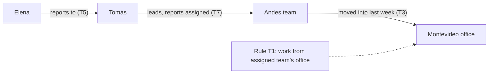

# Stage 3 Test Specs: Cross-Session & Deep Reasoning (draft for review)

Source: [test-expansion-plan.md §Stage 3](file:///c:/Users/sgraz/Documents/Stefano/UNS/Tesis/agent-memory-benchmark/TODOs/test-expansion-plan.md#L77-L133). I checked the harness before drafting: [`ConversationTurn.session_id`](file:///c:/Users/sgraz/Documents/Stefano/UNS/Tesis/agent-memory-benchmark/core/schemas.py#L84-L111) already exists, and the runner switches `thread_id` at session boundaries ([runner.py#L407-L467](file:///c:/Users/sgraz/Documents/Stefano/UNS/Tesis/agent-memory-benchmark/core/runner.py#L407-L467)). The 3.3 prerequisite ("per-turn `thread_id` support") is therefore **already met**, so these YAMLs need **no schema or runner changes**.

## Deliverables

| # | File (actual repo layout `<theme>/<category>/`) | `id` | Sessions | Assertions | Expected L0 / L1 / L2 |
|---|---|---|---|---|---|
| 3.1 | `retention_persistence/cross_thread/test_cross_thread_01.yaml` | `cross_thread_01` | s1 → s2 | 5 (s2 only) | 0% / 0% / 100% |
| 3.2 | `compositional_reasoning/temporal_multi_hop/test_3hop_temporal_01.yaml` | `3hop_temporal_01` | default | 1 | 0% / pass / pass |
| 3.3 | `compositional_reasoning/cross_thread_derived/test_cross_thread_derived_01.yaml` | `cross_thread_derived_01` | s1 → s2 → s3 | 3 (1 probe at T11 + 2 leakage guards at T8–T9) | **Probe (T11):** fail / fail / pass only if retrieval + derivation both succeed. **Scenario `pass_rate`:** 66.7% / 66.7% / up to 100% (guards pass trivially for L0/L1) |
| 3.3c | `compositional_reasoning/in_context_derivation/test_in_context_derivation_01.yaml` | `in_context_derivation_01` | default (1 turn) | 1 | calibrated so it is *not* trivially 100% |

## Cross-cutting assertion policy (applies to all four)

> [!IMPORTANT]
> **Assertions go on probe turns only. Every distractor, premise and decoy turn has `assertions: []`.**
> `pass_rate` is computed over *all* assertions. In older scenarios the distractors carry assertions (e.g. attrition's "Lisbon"), and that hands amnesic agents free credit. These are capability-gate tests, so the L0/L1 score has to be a clean 0%.

> [!IMPORTANT]
> **Only `must_contain` on capability-gate probes. No `must_not_contain`.**
> A safe decline ("I don't have that information") passes every `must_not_contain`. Adding decoy exclusions would give L0 a non-zero score. Shotgun answers are handled with format instructions instead ("city name only", "date only"), which make listing several candidates a clear decision failure.
>
> **One approved exception:** the two leakage-guard assertions on 3.3 turns 8–9 (see 3.3). They are integrity checks, not capability measures. That scenario's headline metric is therefore the **probe turn (T11)**, not the scenario `pass_rate`.

Other rules:
- `turn_number` is global and sequential across sessions. L2 chunk IDs use the form `ep_s<session>_t<turn>`.
- Distractor prompts ask for short answers ("in two sentences"). Long assistant replies would split into several chunks, add to the cost and add noise to top-k.

---

## 3.1 Cross-Thread Memory Retrieval

**Design:** s1 seeds three facts in the middle of the thread, each with a distractor before and after it. The facts are a project name, an exact alphanumeric ID, and a person plus city. A fourth, directional fact includes a decoy city (source vs. target). s2 opens a fresh thread and probes each fact in a separate turn. The probes are ordered so that no answer reveals a later probe's answer.

Each probe is tagged in `metadata.probe_retrieval_types` for the later vector-vs-markdown backend analysis. The `lexical_anchor` probes reuse the exact ID or phrase from the seed turn. The `partial_paraphrase` probe shares only some content words with it.

```yaml
# ─────────────────────────────────────────────────────────────────
# test_cross_thread_01.yaml — Cross-Thread Memory Retrieval
# ─────────────────────────────────────────────────────────────────
# Stage 3.1 (TODOs/test-expansion-plan.md). Facts are seeded in
# session s1 and probed in session s2. The runner gives each session
# its own LangGraph thread_id, so checkpointer memory (L1) cannot
# cross the boundary. Only a cross-thread store (L2 BaseStore /
# VectorDB / .md) can answer. L2 capability gate.
# Assertions live ONLY on s2 probe turns, so amnesic agents score 0%.
# ─────────────────────────────────────────────────────────────────

id: cross_thread_01
name: "Cross-Thread Memory Retrieval"
description: >
  In session s1 the user briefs the assistant on a data-center migration
  (Project Kestrel): a change-ticket ID, a vendor contact and her city, and
  the migration's target data center (with the source facility as a decoy).
  Each fact sits mid-thread between distractors. Session s2 is a new thread
  that probes each fact separately. L0 and L1 must fail (no cross-thread
  memory); L2 must retrieve from the s1 episodes.
category: cross_thread
metadata:
  difficulty: moderate
  sessions: ["s1", "s2"]
  seeded_facts: 4
  distractor_turns: 4
  expected_level_0_behavior: "Fails (0%). No memory at all; safe decline on every probe."
  expected_level_1_behavior: "Fails (0%). s2 opens a fresh checkpointer thread; safe decline."
  expected_level_2_behavior: "Passes (100%). s2 probes retrieve s1 chat episodes via the episodic store."
  probe_retrieval_types:
    turn_9: "partial_paraphrase (project name via 'migration project I'm leading')"
    turn_10: "lexical_anchor (exact ID OPS-58213; 'change ticket' + 'staging cluster')"
    turn_11: "partial_paraphrase ('contact person' / 'work from' vs 'contact' / 'works out of')"
    turn_12: "lexical_anchor + directional decoy (Rosario target vs Buenos Aires source)"
  target_research_question: "P1"

turns:
  # ── Session s1: seeding ─────────────────────────────────────────
  - turn_number: 1
    session_id: s1
    role: user
    content: "Hi! I'm going to use you as my assistant for a data-center migration I'm leading. It's called Project Kestrel. Today I just want to get some background down."
    assertions: []

  - turn_number: 2
    session_id: s1
    role: user
    content: "Before we start: in two sentences, what is a blue-green deployment?"
    assertions: []

  - turn_number: 3
    session_id: s1
    role: user
    content: "For the record, the change ticket for the Kestrel staging cluster is OPS-58213. Every request to the infra team has to quote it."
    assertions: []

  - turn_number: 4
    session_id: s1
    role: user
    content: "Quick one: in two sentences, what's the difference between RAID 1 and RAID 5?"
    assertions: []

  - turn_number: 5
    session_id: s1
    role: user
    content: "Our contact at the hardware vendor, Nordlys Systems, is Ingrid Solberg. She works out of their Oslo office."
    assertions: []

  - turn_number: 6
    session_id: s1
    role: user
    content: "Can you suggest three short agenda items for a migration kickoff meeting?"
    assertions: []

  - turn_number: 7
    session_id: s1
    role: user
    content: "We're moving all Kestrel workloads out of the old Buenos Aires facility and into the new data center in Rosario."
    assertions: []

  - turn_number: 8
    session_id: s1
    role: user
    content: "Great, that's everything for today. Thanks!"
    assertions: []

  # ── Session s2: new thread, probes only ─────────────────────────
  - turn_number: 9
    session_id: s2
    role: user
    content: "Hi, I'm back for a new working session. Remind me: what's the name of the migration project I'm leading?"
    assertions:
      - type: must_contain
        value: "Kestrel"
        case_sensitive: false

  - turn_number: 10
    session_id: s2
    role: user
    content: "I need to file a request with the infra team. What's the change ticket number for the Kestrel staging cluster?"
    assertions:
      - type: must_contain
        value: "OPS-58213"
        case_sensitive: false

  - turn_number: 11
    session_id: s2
    role: user
    content: "Who's our contact person at the hardware vendor, and which city does she work from?"
    assertions:
      - type: must_contain
        value: "Solberg"
        case_sensitive: false
      - type: must_contain
        value: "Oslo"
        case_sensitive: false

  - turn_number: 12
    session_id: s2
    role: user
    content: "And which city is the data center we're moving our workloads into?"
    assertions:
      - type: must_contain
        value: "Rosario"
        case_sensitive: false
```

---

## 3.2 Deep Temporal Multi-Hop (3 hops, in-window)

**Design:** The plan's 3.3 note says 3.2 deliberately keeps every premise inside L1's window. It tests composition over attention, not memory, so it is single-session. The chain is a 3-hop path plus one policy rule, **presented out of chain order** (the last hop comes first):



**Shortcut traps:** each one is a city that a truncated reasoning path would produce.
- **1-hop trap:** Salta (Elena studied there).
- **2-hop trap:** Quito (Tomás grew up there).
- **Sibling trap:** Rosario (the other team's office).

"Temporal" refers to the time-anchored facts ("last week", "since January", "these days"). There is no contradiction, so hedging can't cause a false fail.

```yaml
# ─────────────────────────────────────────────────────────────────
# test_3hop_temporal_01.yaml — Deep Temporal Multi-Hop (3 hops)
# ─────────────────────────────────────────────────────────────────
# Stage 3.2 (TODOs/test-expansion-plan.md). Extends
# temporal_multi_hop_01 (2 hops) to a 3-hop chain plus a policy rule,
# with premises presented OUT of chain order and city decoys planted
# at each truncated-path depth (1-hop, 2-hop, sibling team).
# Single session: every premise stays inside L1's context window, so
# this measures in-window composition, not cross-session memory.
# ─────────────────────────────────────────────────────────────────

id: 3hop_temporal_01
name: "Deep Temporal Multi-Hop (3 Hops)"
description: >
  A policy rule (people work from their assigned team's office) and three
  chained facts (Elena reports to Tomás; Tomás's reports are assigned to the
  Andes team; the Andes team moved into the Montevideo office last week) are
  spread across turns in scrambled order, separated by distractors. Each
  premise turn also carries a decoy city on a truncated reasoning path
  (Salta, Quito, Rosario). The probe asks for Elena's work city and requires
  all three hops plus the rule.
category: temporal_multi_hop
metadata:
  difficulty: hard
  hops: 3
  rules: 1
  distractor_turns: 4
  premise_order: "hop3 (T3) → hop1 (T5) → hop2 (T7)"
  decoys:
    Salta: "1-hop trap. Elena's study city, not her work city."
    Quito: "2-hop trap. Tomás's hometown, not his team's office."
    Rosario: "Sibling trap. Pampas team office."
  expected_level_0_behavior: "Fails. No memory across turns; safe decline."
  expected_level_1_behavior: "Should pass. All premises in-window; failure here is a composition failure, not memory."
  target_research_question: "P1"

turns:
  - turn_number: 1
    role: user
    content: "Some background on how our company organizes people: everyone works from the office of the team they're assigned to. There are no remote exceptions."
    assertions: []

  - turn_number: 2
    role: user
    content: "Unrelated question: what is the time complexity of binary search, in one sentence?"
    assertions: []

  - turn_number: 3
    role: user
    content: "Office news: last week the Andes team moved into our Montevideo office. The Pampas team has been working out of the Rosario office since January."
    assertions: []

  - turn_number: 4
    role: user
    content: "Can you give me two quick tips for running shorter meetings?"
    assertions: []

  - turn_number: 5
    role: user
    content: "About Elena: she reports directly to Tomás. Fun fact, she did her master's degree in Salta."
    assertions: []

  - turn_number: 6
    role: user
    content: "What's the chemical formula of table salt?"
    assertions: []

  - turn_number: 7
    role: user
    content: "And Tomás leads the Andes team. All of his direct reports are assigned to it. He grew up in Quito, so he flies back there a lot."
    assertions: []

  - turn_number: 8
    role: user
    content: "Suggest a short name for a team Slack channel about onboarding."
    assertions: []

  - turn_number: 9
    role: user
    content: "Elena asked me where to ship her new laptop. Based on everything I've told you, which city does she work from these days? Answer with the city name only."
    assertions:
      - type: must_contain
        value: "Montevideo"
        case_sensitive: false
```

---

## 3.3 Cross-Thread Derived Answer + paired in-context control

### Ground truth (verified with `[datetime]::AddDays`)

| Path | Result | Status |
|---|---|---|
| **Jan 20, 2024 + 100 days (leap year)** | **April 29, 2024** | ✅ correct, stated nowhere |
| Leap-year miss / +101 | April 30 | ❌ trap |
| Off-by-one (+99, counting signing day as day 1) | April 28 | ❌ |
| NDA date (Jan 9) + 100 | April 18 | ❌ decoy anchor |
| Contract + warranty offset (90) | April 19 | ❌ decoy offset |
| Contract + Orion offset (60) | March 20 | ❌ decoy offset |
| Contract + 100 + invoice 30 | May 29 | ❌ chained decoy |
| Kickoff (Feb 12) + 100 | May 22 | ❌ decoy anchor |

**Calibration choice (deviates from the plan's illustrative "Mar 3 + 45").** The plan requires the control to be hard enough that a terse strong model isn't trivially at 100%. The changes:
- The span crosses **Feb 29 of a leap year** and three months.
- The probe demands **"date only"**, which rules out visible chain-of-thought. Derivation quality then depends on hidden reasoning, which is exactly the P3 deliberation signal.

The plan's rules (a)–(f) are mapped in the YAML comments.

### Leakage hazard (new, L2-specific)

> [!WARNING]
> In s2 the L2 agent **retrieves s1 episodes**. When the premise-B turn arrives, the model could see "contract signed Jan 20" in its memory block and helpfully volunteer "so delivery is April 29". `append_node` would then store that in s2, and the s3 probe would become verbatim recall. That breaks rule (d): no recall path may exist.
>
> **Mitigations in the spec:**
> - Every premise and decoy turn uses the same "vendor log" framing and ends with "just confirm you've noted it". The premises don't stand out stylistically, and the model is told not to compute.
> - The post-session distractor is fully off-topic. A "deadline calendar" question would invite exactly this computation.
> - **Automatic leakage guards (approved):** `must_not_contain: "April 29"` on **T8** (premise B) and **T9**. Turn 8 is the first point where both premises are available: s1 is retrieved, and s2 already holds the offset. Turn 9 already has turn 8 in its own session history. A failed guard flags the run automatically.
> - **Manual audit (backup):** `metadata.leakage_audit` covers what the guards can't: other date formats ("29 April", "2024-04-29") and T10. Each guard turn has one assertion, which keeps the free credit L0/L1 get to 2 assertions.

**Scoring rule (written into `metadata.headline_metric`):**
- Report **T11 pass/fail** as the 3.3 result.
- Treat a failed T8/T9 guard as a **leaked run**. Its T11 result counts as recall, not derivation, and is excluded from derivation analysis.
- Don't compare scenario `pass_rate` across levels here. L0/L1 score 66.7% just by declining.

### Retrieval note

The s3 probe competes over 10 chat episodes at `top_k=5`. Six of them mention Halcyon (premises plus decoys), so T3 (contract signed) can rank sixth. That is intended difficulty, and `retrieved_memories` telemetry attributes it. **Control pass + composite fail + T3 absent from top-k** means a retrieval failure. **T3 present + wrong date** means an integration failure under RAG context.

```yaml
# ─────────────────────────────────────────────────────────────────
# test_cross_thread_derived_01.yaml — Cross-Thread Derived Answer
# ─────────────────────────────────────────────────────────────────
# Stage 3.3 (TODOs/test-expansion-plan.md). Conjunction of 3.1
# (cross-thread retrieval) and 3.2 (derivation): premise A (anchor
# date) in s1, premise B (offset rule) in s2, probe in s3. The answer
# (April 29, 2024) must be COMPUTED: it appears in no turn of any
# thread. Paired with in_context_derivation_01 (same problem, single
# prompt) to separate retrieval failure from derivation failure:
#   pass control + fail this → memory failure
#   fail both               → reasoning failure
# Plan rules: (a) day-level arithmetic across Feb 29 of a leap year;
# Headline metric is T11; T8-T9 carry automatic leakage guards.
# (b) premises at T3 / T8, never a thread's last turn; (c) probe
# paraphrases ("shipment arrive" ≠ "delivery due", no "signed",
# no "100"); (d) derived date ≠ every stated date; (e) decoy anchor
# dates (s1) and decoy offsets (s2); (f) L0/L1 safe decline.
# ─────────────────────────────────────────────────────────────────

id: cross_thread_derived_01
name: "Cross-Thread Derived Answer (Date Arithmetic)"
description: >
  Session s1 logs vendor paperwork dates, including the Halcyon supply
  contract signing (January 20, 2024) among decoy dates (NDA, kickoff, a
  different contract). Session s2 logs contract terms, including Halcyon's
  delivery deadline (100 calendar days after signing) among decoy offsets
  (warranty, invoice, Orion). Session s3 asks, in paraphrase, for the latest
  on-time arrival date of the Halcyon shipment. The agent has to retrieve
  both premises across threads and do leap-year date arithmetic. The answer
  exists in no stored fact.
category: cross_thread_derived
metadata:
  difficulty: hard
  sessions: ["s1", "s2", "s3"]
  derivation: "2024-01-20 + 100 calendar days = 2024-04-29 (crosses Feb 29, 2024)"
  paired_control: "in_context_derivation_01"
  decoy_derived_answers:
    "April 30": "leap-year miss (or +101)"
    "April 28": "off-by-one (signing day counted as day 1)"
    "April 18": "NDA date + 100"
    "April 19": "contract + warranty 90"
    "March 20": "contract + Orion 60"
    "May 29": "contract + 100 + invoice 30"
    "May 22": "kickoff + 100"
  headline_metric: >
    Turn 11 pass/fail. Turns 8-9 carry leakage guards (must_not_contain
    "April 29"); they pass trivially for amnesic agents, so the scenario
    pass_rate is NOT comparable across levels (L0/L1 = 66.7% by declining).
    A failed guard marks the run as LEAKED: its T11 result is recall, not
    derivation, and is excluded from derivation analysis.
  leakage_audit: >
    The automatic guards cover "April 29" on turns 8-9. Also grep
    agent_response of turns 8-10 for "29 April" and "2024-04-29" (formats
    the guards miss). Any hit means the derived answer was written to the
    episodic store before the probe; treat the run as leaked.
  expected_level_0_behavior: "Fails (0%). Safe decline; no premises available."
  expected_level_1_behavior: "Fails (0%). s3 opens a fresh thread; premises out of window; safe decline."
  expected_level_2_behavior: "Passes only if both T3 and T8 are retrieved into top-k AND the leap-year arithmetic is correct."
  target_research_question: "P1, P3"

turns:
  # ── Session s1 (Thread A): anchor dates ─────────────────────────
  - turn_number: 1
    session_id: s1
    role: user
    content: "I'm coordinating vendor paperwork this quarter and want to keep a running log with you. First entry: the Halcyon NDA was signed back on January 9, 2024. Just confirm you've noted it."
    assertions: []

  - turn_number: 2
    session_id: s1
    role: user
    content: "Side question: in two sentences, what's the difference between a purchase order and an invoice?"
    assertions: []

  # PREMISE A (mid-thread; decoys before and after)
  - turn_number: 3
    session_id: s1
    role: user
    content: "Next log entry: the Halcyon supply contract was formally signed on January 20, 2024. No need to work anything out. Just confirm you've noted it."
    assertions: []

  - turn_number: 4
    session_id: s1
    role: user
    content: "Next log entry: the Orion maintenance contract was signed on February 2, 2024, and our kickoff workshop with the Halcyon team is set for February 12, 2024. Just confirm you've noted both."
    assertions: []

  - turn_number: 5
    session_id: s1
    role: user
    content: "Last thing for today: can you suggest a clear file-naming convention for scanned documents?"
    assertions: []

  # ── Session s2 (Thread B): offset rules ─────────────────────────
  - turn_number: 6
    session_id: s2
    role: user
    content: "New session. Today I'm going through contract terms for the vendor log. Quick one first: what does 'net 30' mean on an invoice, in one sentence?"
    assertions: []

  - turn_number: 7
    session_id: s2
    role: user
    content: "Log entry: under the Orion terms, deliverables are due 60 days after that contract's signing. Also, the Halcyon warranty runs for 90 days from delivery. Just confirm you've noted them."
    assertions: []

  # PREMISE B (mid-thread; decoys before and after)
  # LEAKAGE GUARD: first turn where both premises are reachable (s1 via
  # retrieval, offset in this message). If the model volunteers the derived
  # date here, append_node stores it and T11 becomes recall. A failure marks
  # the run as LEAKED (see metadata.headline_metric). Not a capability score.
  - turn_number: 8
    session_id: s2
    role: user
    content: "Log entry: under the Halcyon terms, delivery is due 100 calendar days after the contract signing date. Again, nothing to calculate yet. Just confirm you've noted it."
    assertions:
      - type: must_not_contain
        value: "April 29"
        case_sensitive: false

  # LEAKAGE GUARD: T8 is now in this thread's history, and "after delivery"
  # invites computing the delivery date first.
  - turn_number: 9
    session_id: s2
    role: user
    content: "Log entry: Halcyon invoices are payable 30 days after delivery. Just confirm you've noted it."
    assertions:
      - type: must_not_contain
        value: "April 29"
        case_sensitive: false

  - turn_number: 10
    session_id: s2
    role: user
    content: "Unrelated: what's the keyboard shortcut to lock a Windows screen?"
    assertions: []

  # ── Session s3: probe (paraphrased, date-only) ──────────────────
  - turn_number: 11
    session_id: s3
    role: user
    content: "What's the latest date the Halcyon shipment can arrive and still be on time? Reply with the date only, in the format Month D, YYYY (for example: March 5, 2023)."
    assertions:
      - type: must_contain
        value: "April 29"
        case_sensitive: false
```

```yaml
# ─────────────────────────────────────────────────────────────────
# test_in_context_derivation_01.yaml — Hard In-Context Derivation
# ─────────────────────────────────────────────────────────────────
# Paired control for cross_thread_derived_01 (Stage 3.3). SAME
# premises and decoys, verbatim and in the same order, minus the
# conversational distractors. Same paraphrased probe and same
# assertion, delivered in ONE prompt. in_context_multihop_01 cannot
# serve as this control: it is at ceiling for all tested models.
# Per-model deltas here measure the raw value of deliberation
# (reasoning tokens) independent of memory architecture.
# ─────────────────────────────────────────────────────────────────

id: in_context_derivation_01
name: "Hard In-Context Derivation (Paired Control for 3.3)"
description: >
  Single-turn control. A vendor log with the exact premises and decoys of
  cross_thread_derived_01 is followed by the same paraphrased question. The
  correct answer (April 29, 2024) needs leap-year date arithmetic and is
  stated nowhere in the prompt. Pass here + fail on cross_thread_derived_01
  means a memory failure; fail on both means a reasoning failure.
category: in_context_derivation
metadata:
  difficulty: hard
  paired_with: "cross_thread_derived_01"
  derivation: "2024-01-20 + 100 calendar days = 2024-04-29 (crosses Feb 29, 2024)"
  expected_level_0_behavior: "Answerable in-context. Not expected to be at ceiling; failures are reasoning failures."
  target_research_question: "P3"

turns:
  - turn_number: 1
    role: user
    content: >
      Here is my vendor log for this quarter. Read it carefully:

      - The Halcyon NDA was signed back on January 9, 2024.
      - The Halcyon supply contract was formally signed on January 20, 2024.
      - The Orion maintenance contract was signed on February 2, 2024.
      - Our kickoff workshop with the Halcyon team is set for February 12, 2024.
      - Under the Orion terms, deliverables are due 60 days after that contract's signing.
      - The Halcyon warranty runs for 90 days from delivery.
      - Under the Halcyon terms, delivery is due 100 calendar days after the contract signing date.
      - Halcyon invoices are payable 30 days after delivery.

      Based strictly on this log: What's the latest date the Halcyon shipment
      can arrive and still be on time? Reply with the date only, in the format
      Month D, YYYY (for example: March 5, 2023).
    assertions:
      - type: must_contain
        value: "April 29"
        case_sensitive: false
```

---

## Decisions (approved 2026-10-23)

| # | Decision | Outcome |
|---|---|---|
| 1 | Assertion policy | ✅ Probes only, `must_contain` only (exception: #3) |
| 2 | 3.3 difficulty | ✅ Leap-year Jan 20, 2024 + 100 days, date-only answer |
| 3 | 3.3 leakage | ✅ **Automatic** `must_not_contain: "April 29"` on T8–T9, plus a manual audit for other formats and T10. T11 is the headline metric. |
| 4 | `in_context_multihop_02` | ❌ Not included |
| 5 | IDs without `test_` prefix | ✅ |

> [!NOTE]
> For the coding-agent prompt later: the four new IDs need entries in `SCENARIO_MAP` in `scripts/reorganize_outputs.py` and `scripts/organize_datasets.py`, unless the dynamic `(theme, category)` inference from the L2 plan §5.4 has already been implemented.
